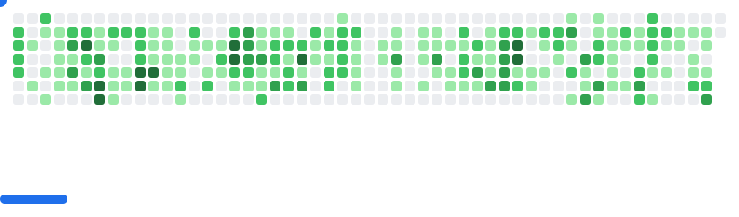

# Nazmul Yeakin Iqra

**Software Engineer — Doin Tech**

Dhaka, Bangladesh · [iqra@doin.tech](mailto:iqra@doin.tech)

---

  

## About Me

Software Engineer at [Doin Tech](https://github.com/Doin-Tech), focused on building reliable backend systems, automation tooling, and scalable cloud infrastructure.

I enjoy designing distributed systems, developing microservices, optimizing database performance, and building automation solutions that solve real-world engineering problems.

My engineering interests include:

- Backend architecture and distributed systems
- REST APIs and microservices
- Event-driven architecture and message brokers
- Database design and performance optimization
- Cloud infrastructure, deployment and automation
- AI-powered applications and intelligent automation

---

## Technology & Frameworks

### Languages

  

### Backend & Frameworks

  

### Databases & Messaging

  

### DevOps, Infrastructure & Tools

  

### Other Technologies

- **API Development:** Django REST Framework, FastAPI, REST APIs
- **Message Streaming:** Apache Kafka
- **Databases:** PostgreSQL, Redis, Neon
- **Infrastructure:** Ubuntu, Linux, Nginx, Docker
- **Cloud & Deployment:** DigitalOcean, Cloudflare
- **AI Integration:** OpenAI API, LLM-powered automation

---

## GitHub Contributions

  <picture>
    <source media="(prefers-color-scheme: dark)" srcset="breakout-dark.svg" />
    <source media="(prefers-color-scheme: light)" srcset="breakout-light.svg" />
    
  </picture>

---

  <i>Good software is built on clarity of thought, discipline in execution, and respect for the systems that people depend on.</i>

  <b>Keep Building. Keep Learning. Keep Improving. 🚀</b>

